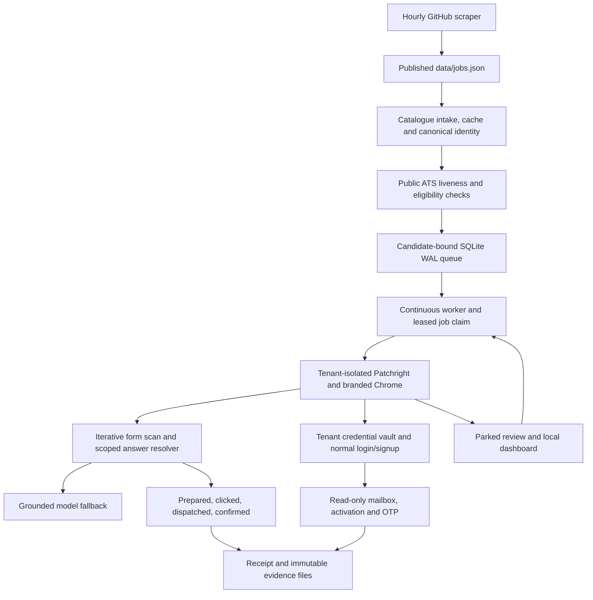
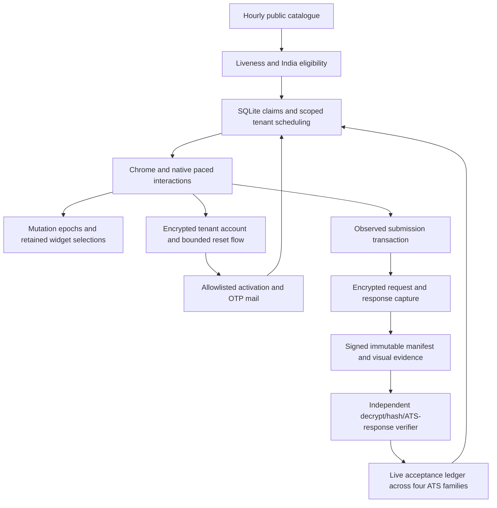

# Autoapply architecture

The worker consumes the scraper's published catalogue, checks eligibility, and
processes a candidate-bound SQLite queue through isolated Chrome contexts per ATS tenant. Unknown
facts and hard browser challenges become durable reviews. A dispatched submission
is never automatically repeated merely because its response was lost.

## Intake and queue

`intake.ts` polls the published hourly source independently of browser work. It
validates rows, caches the source hash and ETag, retries failed source probes even
after HTTP 304, and writes an intake report. Canonical provider/tenant/requisition
keys reuse scraper IDs. URL aliases and normalized URLs provide another dedupe
boundary. The loaded browser URL is checked against the expected requisition when
its ATS exposes an identifiable job URL.

`preflight.ts` rejects closed/stale rows and incompatible experience, location,
citizenship or clearance requirements. It uses public ATS APIs where supported;
generic pages require explicit JobPosting metadata or existing job description.
Transient source failures remain retryable and do not establish closure.

`store.ts` owns SQLite WAL transactions, unique keys, job claims, worker leases,
heartbeats and interrupted-worker recovery. Legacy queue JSON is imported once
without overwriting its bytes. SQLite is authoritative after migration. Existing
receipts and applied jobs remain protected from automatic retry transitions.

## Browser and answers

`runner.ts` uses Patchright and installed branded Chrome, headed by default.
It processes one current control at a time, blurs it, observes DOM/shadow-root
mutations, waits for dependent fetch/XHR completion, and rescans. Unstable or
invalid forms stop before submission. Stealth interaction mode adds log-normal
typing delays, reading pauses and pointer movement before Submit.

`answers.ts` owns global, jurisdiction and employer/requisition scopes, boolean
polarity, skill boundaries, salary units and notice units. Employer-specific
answers are never inferred from a generic former-employee flag. The extension
bundles this same resolver through `scripts/build-extension.mjs`; its source is
`extension/content/content.source.js`.

`grounded-model.ts` follows Chain-Code's ordered fallback/circuit-breaker design.
Z.ai Flash and OpenRouter's free route are defaults. Groq/Gemini account free tiers
require `AUTOAPPLY_ALLOW_ACCOUNT_FREE_TIERS=1`. Output must match a schema, cite
available facts, reach confidence 0.85, and agree with a value recomputed locally.
Identity/contact/consent values stay local. Missing facts produce a review.

## Login, email and challenges

`vault.ts` encrypts credentials with AES-256-GCM and binds ciphertext to tenant.
Windows protects the master key with CurrentUser DPAPI. Atomic exclusive
publication prevents competing workers replacing the first tenant credential.
Passwords derive from a versioned HMAC of the protected master key, tenant and candidate email; candidate-name/email substrings are excluded. Other platforms require an explicit 32-byte base64 vault key.

`authentication.ts` uses normal Workday/iCIMS sign-in and account controls, saves
deterministically derived passwords, follows validated same-tenant activation links in the same
browser context, and returns to the application. Unknown account consents remain
review gates. Real portal variations may still require a saved session or owner
intervention; local fixtures do not establish universal portal compatibility.

`mailbox.ts` accesses IMAP over TLS in read-only mode. Verification requires an
allowlisted authenticated sender, matching recipient, fresh timestamp and company
correlation where supplied. Codes fill normal single/split inputs.
`mail-evidence.ts` durably assigns messages to applications. Confirmation email
also requires role title or requisition correlation before upgrading a receipt.

True reCAPTCHA, hCaptcha, DataDome and Cloudflare gates are detected and parked for
the owner. The system watches clearance and resumes ordinary automation. No
general CAPTCHA-solving or reliable bot-evasion guarantee is implemented.

## Reviews and continuous operation

`worker.ts` continues intake while browser work runs. Reviews retain checkpoint,
storage state, sanitized DOM, screenshot and grouped missing questions.
`dashboard.ts` provides local-only open/answer/continue controls with Host, Origin
and CSRF checks. Unsaved drafts survive refresh. Three live parked tabs are kept;
additional reviews remain stored and reopenable. Restart restores saved reviews.

`scripts/run-autoapply.ps1` starts the worker with the saved candidate state.
`scripts/install-autoapply-startup.ps1` configures a current-user interactive
Windows logon task with bounded crash restart. `-Submit` enables final submission;
without it, completed forms remain for review. `-Remove` removes that startup task.
Credentials are read from the local ignored `.env`, never from command arguments.

## Submission and proof

Before Submit, the runner records visible field values and uploaded document byte
hashes. `submission.ts` observes mutating requests and responses across related
application pages/popups, excluding known telemetry. It stores dispatch time,
payload hash, response status and header/body hashes. A successful HTTP status by
itself is insufficient proof. Known Ashby/Workday structured success and explicit
confirmation elements can establish receipt. Footer/nav/aside prose is excluded.

Visible client validation with zero observed mutations permits review retry.
Lost responses, unclassified mutations and crash windows remain conservative.
Restart navigates the saved page and reconciles the existing application without
another Submit click. OTP processing continues for parked/recovered transactions.

`evidence.ts` creates unique receipt directories with exclusive writes containing
receipt metadata, submitted fields/document hashes, sanitized confirmation HTML,
screenshot and a SHA-256 manifest. Email reconciliation creates another immutable
proof directory; queue metadata retains the prior DOM-evidence reference. Email
upgrades preserve application date/count. A capture failure is explicitly recorded
and does not fabricate missing evidence.

## Verification and limits

Local tests cover remounts, shadow DOM, delayed dependent fetches, employer scope,
polarity/skill/unit traps, real local SMTP single/split OTP, OTP browser restart,
tenant signup/activation, actual Windows DPAPI reopening, competing credential
writers, worker park/restart, validation bounce, lost-response SIGKILL recovery,
popup closure/parent confirmation, footer text and evidence hashes.

`scripts/cdp-diagnostic.ts` runs SHA-256-pinned functions from upstream rebrowser
detector blob `decf524adca8d6306120adafdbe91407dde7adb4` locally against the actual
launcher. Runtime.enable, webdriver and sourceURL probes passed; automation could
not access the main-world dummyFn sentinel. These narrow diagnostics do not prove
invisibility to employer anti-abuse systems.

The Windows CI workflow includes typecheck, extension build, browser regressions,
pinned Mailpit OTP tests and CDP diagnostics. Remote CI requires a push/PR and is
not established by local results. Provider quotas, mailbox sender authentication,
employer UI changes and owner-only challenges remain external dependencies.

## Changes from the earlier runner

- Replaced JSON/process-lock queue ownership with SQLite WAL claims and recovery.
- Added continuous hourly-catalogue intake and public liveness/eligibility probes.
- Replaced one-pass form filling with mutation/request-aware rescans.
- Consolidated scoped answers across the worker and extension; added grounded
  Chain-Code-style model fallback with local fact verification.
- Added encrypted tenant credentials, normal signup/sign-in, activation and OTP.
- Added durable parked reviews, grouped questions and safe restart handling.
- Added observed submission phases, popup/parent recovery and immutable proof
  bundles with exact uploaded-byte hashes and asynchronous email reconciliation.
- Added local fault acceptance, reproducible Mailpit/CDP diagnostics, a Windows CI
  workflow and runnable Windows startup configuration.

The user explicitly chose to keep changes local. No commit, push or remote CI
execution was performed. Startup was not enabled and no new live applications
were sent during this implementation acceptance.

## New ticket architecture and production gate

The follow-up ticket source is attachment
`cea95d95-f5b6-44ad-8c05-754ba9d2691b/pasted-text-1.txt`. Its live exit criterion
is stricter than the earlier local implementation goal. Production readiness is
not established by fixture tests or the three preserved historical applications.

The vault's v2 password policy generates deterministic 16-character credentials
with upper/lower/digit/symbol classes, no adjacent identical characters and no
candidate-name/email substrings. Existing credentials remain unchanged. Recovery
retains the old credential until an explicit reset confirmation, saves pending
state encrypted, and allows two reset requests per tenant in 30 minutes. Delayed
activation/reset messages can wake a parked authentication job automatically.

Form rescans now include ARIA values and React-Select single/multi-value pills.
Request tracking uses document epochs, so same-URL reloads discard obsolete
requests while asynchronous current-document fields still settle. Pacing uses
actual trusted keyboard events and cubic pointer paths for checkbox, radio,
dropdown, navigation, authentication, OTP and submission interactions. Hardware
APIs remain native; launcher checks establish native viewport/API behavior, not
universal invisibility to employer detection systems.

Terminal response adapters cover explicit Ashby/Workday success and
Greenhouse/Lever JSON success or known confirmation redirects. Generic HTTP 200
and validation JSON cannot establish success. Related-page observations remain
attached while a submission is parked, so late API-only receipts reconcile
without another Submit click. Background review tabs cannot contaminate them.

Raw browser-exposed request payloads, response bodies and headers are encrypted
with tenant/requisition-bound AAD. Their original hashes remain in transaction
metadata. Bundle manifests receive an HMAC using the protected local master key.
`verify-autoapply-evidence.ts` independently decrypts raw captures, recomputes
hashes, checks candidate/requisition binding and re-parses ATS response semantics.
HTML snapshots are inert under a restrictive CSP and strip active content and
sensitive URL parameters. HMAC authenticates the local collector; these are not
employer-issued digital signatures. Browser APIs may omit multipart file bytes;
exact uploaded document byte hashes are captured separately.

`audit-autoapply-acceptance.ts` audits the saved queue read-only. The ledger
requires a new, signed, autonomous, public-HTTPS, network-verified receipt for a
unique requisition/application. Existing applications, localhost fixtures,
observed human-review requirements, unsigned proofs and invalid captures are
excluded. At least one verified application from Workday, Greenhouse, Lever and
Ashby is required. A worker campaign can use `--submit --target-successes 50`;
it prioritizes missing ATS coverage and stops only when the full gate is met.

Automatic verification keeps bounded live slots. Pending verification prevents a
second application at the same tenant from consuming an ambiguous email. Intake
continues independently; unresolved verification becomes a durable review after
15 minutes. No required employer fact or consent is invented to satisfy the gate.

Current real baseline is **0/50 qualifying runs**. The three earlier application
receipts are preserved and excluded. The live gate remains incomplete. Full
post-ticket regression and the live campaign must be inspected before claiming
production readiness. Git changes remain local as explicitly requested.

The approved live campaign uses `--approved-jobs out/campaign-proposal.json`.
This pins browser processing and recovered reviews to the exact listed URLs,
even while hourly intake imports other catalogue records. An isolated worker
test proves that unapproved queued and parked jobs remain untouched and that
one-shot execution terminates when only unapproved jobs remain. Native CAPTCHA
and employer-specific question gates still park rather than inventing answers.

On 2026-10-31, public intake encountered five empty application URLs among
18,373 postings. Empty-link postings are omitted before queueing. Other schema
violations still reject the snapshot. Five intake tests pass with this case.

Authentication gates are rechecked after mutation-driven autofill. If password
controls mount during a field change, generic filling stops and the next runner
step invokes tenant authentication. Passwords never become missing candidate
answers. Sixteen dynamic-form and Workday authentication regressions passed
following this repair; typecheck passed. The already-running campaign retains
its loaded code until a safe checkpoint permits restart.

Paced typing verifies exact final control values after blur. A mismatch receives
one native-fill repair; a second mismatch stops the step without exposing the
entered value in an error. Standard recruitment privacy acknowledgements can be
automated only when recruitmentPrivacyConsent is explicitly saved. The shared
matcher rejects optional marketing, recording, unrelated declarations and
negative wording. Existing scoped answers take precedence in form resolution.
Account authentication uses the same matcher before account creation.

Sequential diagnosis runs pin --approved-jobs to one previously approved role.
The intake filter also excludes other employers from live probes. Workday inline
account-verification and email-sent messages join heading-based email gates;
matching tenant activation mail resumes authentication. A one-shot worker keeps
bounded automatic verification reviews alive rather than exiting before mail
arrives. Live portal outcomes remain required to establish acceptance.

Real Workday verification mail also uses otp.workday.com. The mailbox allowlist
includes that exact domain and still requires authenticated mail, the intended
recipient and a fresh receipt time. Generic activation emails can bind to the
exact tenant-specific myworkdayjobs.com hostname even without company-name text.
Generic codes retain company correlation; shared ATS hostnames do not receive
this exception. Historical review status remains in audit evidence separately
from whether automatic verification is currently pending.

Account activation tabs wait for bounded network quiet before closure because
activation can require JavaScript after DOM readiness. Gate inspection skips
only frames proven detached, while surviving login gates and unrelated errors
remain enforced. These repairs have focused browser regression coverage. They
do not establish the 50-application production acceptance gate.

Workday search widgets may use data-uxi-widget-type=selectinput without an ARIA
combobox role. The runner recognizes these widgets and selectedItem pills during
rescans. Option resolution waits for a matching result instead of treating any
visible option, including an unrelated selected phone-code pill, as readiness.
Dialing-code matching compares exact +code suffixes and rejects ambiguity.

The loopback review dashboard also supports a single-step continuation through
`POST /api/step`. It uses the existing action token, origin/host checks and
candidate-owned review cards. The worker retains the current application tab,
refreshes its profile, and runs with `maxSteps: 1` and `submit: false` for this
action even when the campaign has submission permission. `--review-steps` applies
the same restriction to initial and recovered work. Normal review continuation
can restore the campaign's authorized submission setting. The helper
`scripts/reconcile-current-step.ts` waits for the resulting completed checkpoint;
a timeout never starts another worker or retries Submit.

An expired Workday saved apply route can return only the public header. When
that specific shell has a visible sign-in header, no application controls and
no detected challenge, the runner reopens the same approved posting to enter
its application flow. It does not change tenant or requisition. A local browser
fixture covers this recovery without final submission.

`ATS_STRATEGIES` in `wizard.ts` centralizes domain detection, form markers and
legacy navigation hints for Workday, Greenhouse, Lever, Ashby, iCIMS,
SmartRecruiters, Workable, Oracle HCM, SAP SuccessFactors, Taleo and Recruitee.
The shared runner owns every frame and uses native locators for open shadow
roots. Labels and popup references resolve within their own root. Platform
contracts and limits are documented in `docs/autoapply-ats-coverage.md`.

Workday rescans stay inside application field containers and exclude popup
internals and beecatcher. Per-field mutation attempts are bounded to two per
fill pass. An exhausted required value blocks progression while other controls
still fill. Known hierarchy categories lead only to the requested source leaf.
Controls scroll to the center before clicks so sticky footers do not intercept
them. A verified sibling click_filter receives one native click when it covers
the intended control. Workday transitions wait for loading indicators and disabled
footers to clear before accepting an active-step change. No timeout alone
authorizes another final Submit click.
