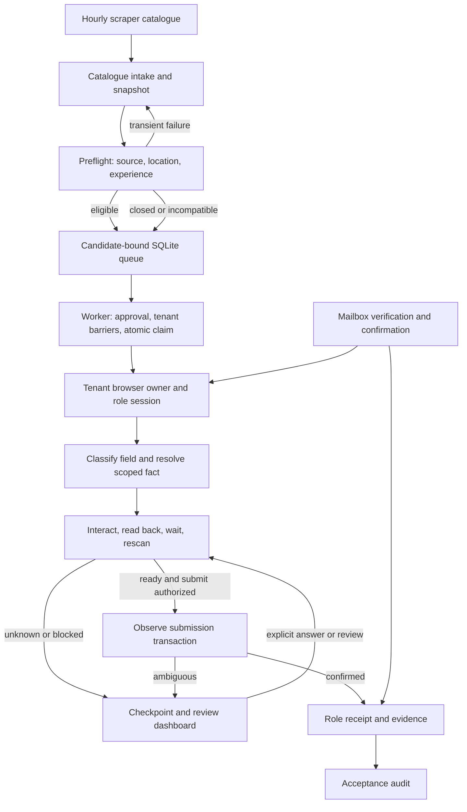

# Autoapply architecture and next steps for Argon

Snapshot: 2026-10-31. This describes the local checkout, including uncommitted
work. It is not a production-readiness claim. Read `HANDOFF.md` first, then
`docs/autoapply-audit-2026-10-31.md` sections 11–15 and
`docs/autoapply-audit-followup-2026-10-31.md`. The audit's owner decisions in
sections 14–15 supersede earlier recommendations. Some older architecture text
describes model fallback as if it were the current default; it is not.

## Goal and boundaries

Take eligible jobs from the scraper's catalogue, apply truthful candidate facts
to employer forms, and record a separate, verifiable receipt for each completed
application. Unknown required facts, legal answers, authorizations and consents
must become review items. Never invent them. Target roles requiring 0–3 years;
that target is independent of the candidate's actual experience, which must
remain truthful in employer-facing fields.

The owner chose deterministic operation and no full test suite. The worker
constructs a model only when `AUTOAPPLY_NO_MODEL=0`; its default is disabled,
even when keys exist in `.env`. Do not enable it as a workaround. Use focused
captures, small replays, typecheck and sequential live evidence. Keep secrets,
personal values, mailbox bodies, browser storage, OTPs and activation links out
of logs and handoffs.

The authorized live submission boundary is the exact URLs in
`out/campaign-proposal.json`. `out/sequential-abb.json` is ABB-only. A rolling
approval, daily caps and fit rules are proposals, not installed authorization.
The original 50-role list cannot produce 50 successes as it stands because of
closures and skips. Prepare a concrete expanded scope before requesting approval;
do not silently apply to other URLs. Never commit or push as part of this handoff.

## End-to-end flow

Intake and the browser worker are linked but run independently: the worker can
poll while a browser task is in progress. Preflight happens on intake and again
before a claimed job runs. A transient error must stay retryable; it is not proof
that the role closed. A submission is only applied when a receipt is present.

## Components and ownership

| Component | Responsibility and important link |
| --- | --- |
| `src/autoapply/intake.ts` | Fetches the published catalogue with ETag, validates and caches it, deduplicates by requisition, runs bounded preflight and adds decisions to the queue. `intake-report.json` is overwritten, so it is not history. |
| `preflight.ts` | Checks public source liveness and compatibility. Eligible, skipped and retry are distinct. It now uses `MAX_YEARS` from `src/config.ts` for the target band. Earlier experience skips were not requeued. |
| `identity.ts` | Produces canonical requisition and employer/tenant keys. These keys connect deduplication, tenant scheduling, answer scope, browser isolation and receipt association. Do not group merely by display name. |
| `autoaply.ts` | Queue transitions, ordering and per-company dispatch preference. Its `processNext` checks eligibility, claims one role, and interprets runner outcomes. A role claim and receipt remain separate even when a company browser is reused. |
| `store.ts` | SQLite WAL, candidate binding, uniqueness, atomic claims, worker leases and recovery. Legacy JSON imports once; SQLite owns state afterward. A recovered `applying` claim becomes review rather than an automatic resubmission. |
| `worker.ts` | Coordinates intake, queue, tenant browser owners, review state, mailbox, approval list and acceptance. Blocks sibling roles when a tenant has an unresolved request, submission or automatic review. |
| `runner.ts`, `wizard.ts`, `widgets.ts` | Browser lifecycle, ATS-specific controls, form scanning, interactions, dependent-request tracking, read-back and checkpoints. Extend the responsible platform or semantic layer after capturing the actual failure. |
| `classifier.ts`, `answers.ts`, `profile.ts`, `types.ts` | Classify fields, resolve known profile facts and scoped answers, validate the profile and describe reports. Company answers require explicit company scope; role-specific answers override them. Unknown required answers park. The extension uses the shared resolver. |
| `authentication.ts`, `vault.ts`, `mailbox.ts`, `verification.ts`, `mail-evidence.ts` | Tenant credential storage, normal authentication, read-only mail verification and durable mail claims. Confirmation mail needs role correlation; a company-only message must not be assigned to multiple pending roles. |
| `submission.ts`, `network-proof.ts`, `evidence.ts`, `evidence-verifier.ts` | Observe the submission, interpret supported provider responses, record evidence and independently verify bundles. An HTTP 200 alone is not a receipt. |
| `dashboard.ts` | Local review interface for questions and controls. Answers write to the candidate profile with explicit role or company scope; the worker reloads the profile. |
| `acceptance.ts` | Applies the stricter production acceptance gate to saved evidence. Local fixture receipts and the three historical manually completed/reconciled receipts do not establish new autonomous production successes. |

## State and transaction boundaries

The current working state is under `state/autoapply/portal-review`. Treat it as
sensitive. `queue.sqlite` contains job state and leases. `candidate.json` contains
candidate facts. `applications/<role hash>/` contains checkpoints and evidence;
`browsers/<tenant hash>/` contains tenant browser state. The vault and mail claims
have their own storage. `worker.json` is an observation, not an authoritative
process registry. Inspect state without printing its sensitive contents.

Typical progression is `queued` → `applying` → `applied`, `skipped`, `failed`,
or `paused_for_review`. Transient preflight failure returns the role to `queued`
with a later attempt. A submitted outcome without a receipt cannot become
`applied`. The submission observer distinguishes preparation, click, dispatch and
confirmation. A lost response or crash after dispatch is ambiguous. Reconcile it
against saved evidence, employer state or correlated confirmation mail before
considering another click. Do not equate a browser timeout with a failed POST.

Same-company processing uses a canonical ATS tenant key, an in-memory preference
for the current company and an isolated browser owner/profile per tenant. Each
requisition has its own queue claim, checkpoint and receipt. Native Workday
"Use My Last Application" is allowed only after another role at that employer is
marked applied with a receipt. It does not waive validation of role-specific
answers. An unresolved request or submission blocks sibling roles at that tenant.

On restart, the legacy ABB timeout is recognized as an unfinished request.
Recovery now leaves such a role parked, including when profile data changes,
until explicit review. Mail reconciliation still runs. Dashboard resume can
initiate recovery; opening alone does not reopen an ambiguous application. Verify
the employer-side outcome before using resume. Avoid starting duplicate workers.

## Evidence and current limits

- Local company browser fixture passed after the strong-label correction. It
  checked A1 → A2 → B1 ordering, same-tenant cookie reuse, cross-tenant isolation,
  three POSTs and separate receipt directories. This was a local HTTP fixture,
  not a live employer application.
- A focused restart fixture passed for a legacy timed-out request and a queued
  company sibling. Earlier focused company and prefill regressions are recorded
  in `out/company-batches-regression.log` and
  `out/company-prefill-regression.log`.
- TypeScript typecheck passed after the latest worker and fixture changes. No
  full suite ran, per owner decision. Restricted tsx startup failed at Windows
  `uv_os_get_passwd` with ENOMEM; the focused fixtures ran with normal account
  access through the approved route.
- `worker.json` now refreshes `heartbeatAt` and `observedAt` every 15 seconds
  while the event loop runs and includes `startedAt`. OBS-04 is incomplete:
  there is no reader checking PID, process start time and heartbeat freshness,
  and no predecessor crash record. The historical file said PID 30372 was
  running, but that PID was absent when last checked. Recheck live state.
- Last observed production acceptance was 0/50. No new autonomous production
  receipt was established in the latest continuation. The ABB job
  `autoaply_1793386531960_i5daq7` had an unfinished same-origin POST, a
  15-minute timeout, `submissionAttempted=false`, and no receipt. That flag
  does not prove no mutation occurred. Its saved session is under
  `applications/07c4048d5cb729a9759d`. Do not retry blindly.

## Next steps in dependency order

1. **Inspect current state before action.** Check worker PID and process start,
   queue and checkpoint summaries without exposing candidate data. Identify
   ambiguous submissions and reconcile them first. Preserve all existing
   receipts. Treat historical parks as hypotheses until checked on current code.
2. **Finish truthful observability.** Complete OBS-04 with a liveness reader
   that checks PID, matching process start and fresh heartbeat; distinguish stopped
   and crashed. Add OBS-02 structured, closed reason codes at the outcome owner,
   retaining sanitized human-readable reasons and unknown cases. Existing catch
   paths can store raw error messages, so audit redaction before persisting them.
3. **Make outcomes explainable.** OBS-05 needs durable, privacy-safe per-role
   events from claim through preflight, steps, park, submit phases and outcome.
   Record counts and codes, never field values or secrets. OBS-03 status/explain
   should read the queue and journal without changing them and show next action,
   liveness and acceptance age. Retain intake decision evidence separately;
   the current latest report is overwritten. Keep compatibility with old rows.
4. **Inspect deterministic semantics before adding rules.** The classifier,
   resolver and ATS recipes already have fuzzy and platform-specific support.
   Use standard autocomplete and existing stable ATS markers where applicable,
   resolve only supported facts, verify selected values after interaction and
   park unknown required values. Reproduce a real captured failure first.
5. **Revalidate stale parks sequentially without submission.** Capture sanitized
   current state, identify the exact blocked step, and compare with historical
   checkpoint. Do not retry an ambiguous POST or repeatedly reopen the same stale
   review. Prefer a bounded local replay for a reproducible failure class.
6. **Run approved canaries sequentially.** Start only after confirming no active
   worker and reconciling ambiguous work. Use exact approved URLs, inspect each
   outcome and receipt before the next attempt, and stop on a new failure class.
   A local browser fixture is not a live receipt. Continue only within the
   existing approved scope; request one concrete new scope if the list runs out.
7. **Reassess acceptance and operations.** Measure real per-provider outcomes,
   protect state and decide retention/backup, then address fit, caps and rolling
   authorization only with the owner's required decisions. Do not infer consent
   to talent pools, age declarations or legal/work authorization answers.

## Avoid the previous loop

Long Workday runs repeatedly surfaced one failure at a time, while stale parks
were retried without establishing their current state. Generic queue messages
hid the actual checkpoint; arbitrary waits and broad fixture success created an
illusion of progress without new receipts. For each failure, capture the exact
sanitized state, locate the responsible layer, fix the class, demonstrate the
next transition with a small replay or canary, and record the next action. Stop
repeating the same unresolved Submit or POST.

Research is already in `docs/autoapply-open-source-research.md` and
`docs/autoapply-rea-findings.md`. The Simplify Copilot inspection is partial
static evidence, not proof of runtime reliability. Do not repeat that research
unless a specific unresolved implementation question requires it.
